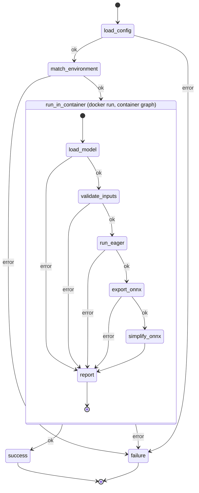

# Architecture

The check is two LangGraph state machines. The host graph validates the
user's config and environment, then starts the matched environment's Docker
container with the GPU attached and runs the container graph inside it. The
container graph writes `report.json` to a directory the host mounted; the host
merges it into its own state, so `failure` picks the customer message the
same way for both graphs. The files the checks produce for the user go to the
artifact directory, which the host creates and mounts.

Every node either advances the state or records a failure stage in
`error` and `error_detail`; `route_on_error` sends any failure to `failure`.

## Host graph

- `load_config` (`env_check.py`): reads and validates the user's `config.yaml`
  against the Pydantic schema in `config.py`. Stages: `read_config`,
  `validate_config`.
- `match_environment` (`env_check.py`): loads `environments.yaml`, finds the
  entry equal to the config on all five fields, and checks the host GPU via
  `nvidia-smi` and the image via `docker image inspect`. Stages:
  `load_environments`, `match_environment`, `host_gpu`, `image_available`.
- `run_in_container` (`container.py`): creates the artifact directory,
  deletes the managed files listed in `artifacts.py` from a previous run, runs
  the container graph with `docker run --gpus all`, `model.py` and
  `input.npz` mounted read-only and the report and artifact directories
  mounted writable, then validates `report.json` and requires the exit code
  to agree with it. Stage: `container_run`; a
  failure reported by the container is passed through under its own stage.
- `success` / `failure` (`workflow.py`): set `outcome` and the
  `customer_message`, looked up by stage in `messages.py`.

## Container graph

Run by `python -m kronos_edge.eager_check` with `--device cuda`.

- `load_model` (`eager_check.py`): selects the device, imports `model.py`,
  finds `Model` and `get_inputs()` or `get_fwd_args()`, and constructs the
  model. Stages: `select_device`, `import_module`, `find_model_class`,
  `find_get_inputs`, `init_model`.
- `validate_inputs` (`eager_check.py`): calls `get_inputs()`, loads
  `input.npz`, and checks keys, shapes, and dtypes. Stages: `get_inputs`,
  `load_npz`, `validate_inputs`.
- `run_eager` (`eager_check.py`): one forward pass under `torch.no_grad()`.
  Stage: `forward`.
- `export_onnx` (`onnx_check.py`): `torch.onnx.export(..., dynamo=True)` on
  the same model and inputs; keeps the `ModelProto` in state and writes
  `model.onnx` with `ONNXProgram.save`, external data above 2 GB. Stages:
  `onnx_exporter`, `onnx_capture`, `onnx_convert`, `onnx_save`.
- `simplify_onnx` (`onnxsim_check.py`): `onnxsim.simplify` on the model in
  state; keeps the result in state, writes `model_simplified.onnx` with
  external data above 2 GB, and checks the file with `onnx.checker`. Stages:
  `onnx_simplifier`, `onnx_simplify`, `onnx_simplified_invalid`,
  `onnx_simplified_save`.
- `report` (`eager_check.main`): writes `error` and `error_detail` to
  `report.json` and exits 1 on error, 0 otherwise.
