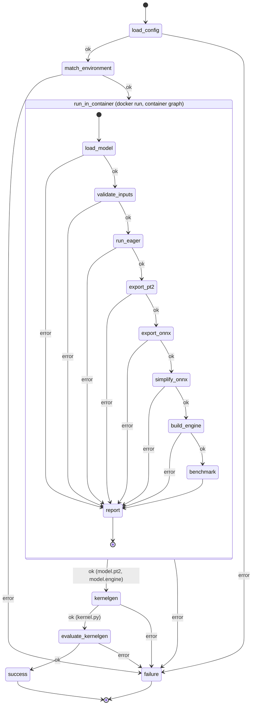

# Architecture

The check is two LangGraph state machines. The host graph validates the
user's config and environment, then starts the matched environment's Docker
container with the GPU attached and runs the container graph inside it. The
container graph writes `report.json` to a directory the host mounted; the host
merges it into its own state, so `failure` picks the customer message the
same way for both graphs. Once the container has succeeded, the host runs the
kernelgen steps through the `yasp-toolkit` command, which needs the user's
Yasp API key and so stays on the host. The files the checks produce for the
user go to the artifact directory, which the host creates and mounts; the
container's `model.pt2` and `model.engine` in it are what the host's
`kernelgen` node depends on.

Every node either advances the state or records a failure stage in
`error` and `error_detail`; `route_on_error` sends any failure to `failure`.

## Host graph

- `load_config` (`env_check.py`): reads and validates the user's `config.yaml`
  against the Pydantic schema in `config.py`: the five environment fields plus
  the `precision`, `metric`, `threshold`, and `eval_routing` settings, all
  required. Stages: `read_config`, `validate_config`.
- `match_environment` (`env_check.py`): loads `environments.yaml`, finds the
  entry equal to the config on the five environment fields, and checks the host GPU via
  `nvidia-smi` and the image via `docker image inspect`. Stages:
  `load_environments`, `match_environment`, `host_gpu`, `image_available`.
- `run_in_container` (`container.py`): creates the artifact directory,
  deletes the managed files listed in `artifacts.py` from a previous run, runs
  the container graph with `docker run --gpus all`, `model.py` and
  `input.npz` mounted read-only, the report and artifact directories mounted
  writable, and the precision passed on the command line, then validates `report.json` and requires the exit code
  to agree with it. Stage: `container_run`; a
  failure reported by the container is passed through under its own stage.
- `kernelgen` (`kernelgen_check.py`): requires `model.pt2` and `model.engine`
  in the artifact directory (the TensorRT output it waits for), then runs
  `yasp-toolkit kernelgen compile` as a subprocess with the reference, the
  user's `model.py` as source, the config's `gpu` as target, and the config's
  `eval_routing` for the in-compile evaluations; the command polls the job
  until it is terminal. Requires `kernel.py` to exist afterwards (the toolkit
  exits 0 after some early errors) and records its path in `kernel_path`.
  Stages: `kernelgen_reference`, `kernelgen_engine`, `kernelgen_toolkit`,
  `kernelgen_credentials`, `kernelgen_compile`.
- `evaluate_kernelgen` (`kernelgen_check.py`): runs `yasp-toolkit eval compare`
  on `kernel_path` against `model.pt2` for the config's `gpu`, routed to the
  evaluator registered from this machine by `eval_routing`; writes the
  evaluator's results as `kernelgen_eval.json`, requires its correctness
  checks to pass, and records the result and the speedup in
  `kernelgen_result` and `kernelgen_speedup`. Stages: `kernelgen_eval`,
  `kernelgen_eval_results`, `kernelgen_eval_incorrect` (plus the toolkit and
  credentials stages above).
- `success` / `failure` (`workflow.py`): set `outcome` and the
  `customer_message`: the benchmark numbers and the kernelgen speedup on
  success, or the message looked up by stage in `messages.py`.

## Container graph

Run by `python -m kronos_edge.eager_check` with `--device cuda` and the
`--precision` and `--threshold` from the config.

- `load_model` (`eager_check.py`): selects the device, imports `model.py`,
  finds `Model` and `get_inputs()` or `get_fwd_args()`, and constructs the
  model. Stages: `select_device`, `import_module`, `find_model_class`,
  `find_get_inputs`, `init_model`.
- `validate_inputs` (`eager_check.py`): calls `get_inputs()`, loads
  `input.npz`, and checks keys, shapes, and dtypes. Stages: `get_inputs`,
  `load_npz`, `validate_inputs`.
- `run_eager` (`eager_check.py`): one forward pass under `torch.no_grad()`
  on copies of the inputs. Stage: `forward`.
- `export_pt2` (`pt2_check.py`): `torch.export.export` on the model and
  inputs in state, under `torch.no_grad()`, decomposed to Core ATen (what
  `yasp-toolkit kernelgen export` produces); the model is not cast. Keeps the
  `ExportedProgram` in state and writes `model.pt2` with `torch.export.save`.
  Runs first after the eager pass so the host's kernelgen reference exists
  before the ONNX chain starts. Stages: `pt2_capture`, `pt2_save`.
- `export_onnx` (`onnx_check.py`): casts a copy of the model and its float
  inputs to the configured precision unless they already have it, leaving
  the eager model in state untouched; then
  `torch.onnx.export(..., dynamo=True)`; keeps the `ModelProto` in state and
  writes `model.onnx` with `ONNXProgram.save`, external data above 2 GB.
  Stages: `onnx_precision`, `onnx_exporter`, `onnx_capture`, `onnx_convert`,
  `onnx_save`.
- `simplify_onnx` (`onnxsim_check.py`): `onnxsim.simplify` on the model in
  state; keeps the result in state, writes `model_simplified.onnx` with
  external data above 2 GB, and checks the file with `onnx.checker`. Stages:
  `onnx_simplifier`, `onnx_simplify`, `onnx_simplified_invalid`,
  `onnx_simplified_save`.
- `build_engine` (`tensorrt_check.py`): parses `model_simplified.onnx` from
  the artifact directory into a strongly typed TensorRT network, so the
  engine's precision is the ONNX's, pins shape inputs and dynamic dimensions
  to the user's inputs with an optimization profile, builds a serialized
  engine, keeps the bytes in state, and writes `model.engine`. TensorRT's own log is forwarded to ours
  and its errors become the customer detail. Stages: `tensorrt_import`,
  `tensorrt_parse`, `tensorrt_build`, `engine_save`.
- `report` (`eager_check.main`): writes `error`, `error_detail`, and the
  `benchmark` to `report.json` and exits 1 on error, 0 otherwise.
