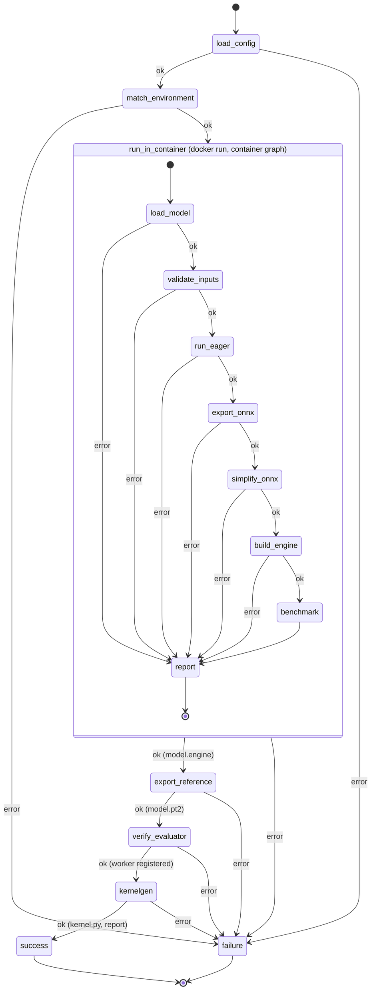

# Architecture

The check is two LangGraph state machines. The host graph validates the
user's config and environment, then starts the matched environment's Docker
container with the GPU attached and runs the container graph inside it. The
container graph writes `report.json` to a directory the host mounted; the host
merges it into its own state, so `failure` picks the customer message the
same way for both graphs. Once the container has succeeded, the host runs the
documented `yasp-toolkit kernelgen export` in a second container from the
export image (CPU-only torch and `yasp-agent`, no GPU, no key) to write the
kernelgen reference, confirms with `yasp-toolkit eval workers` that the user's
persistent Gaia worker for the config's GPU and routing key is registered, and
runs `yasp-toolkit kernelgen compile` and `yasp-toolkit eval inspect` on the
host. Every Yasp interface used is a command documented at
https://compile.yasp.ai/help/; the repository orchestrates Gaia and implements
none of it. The user's Yasp API key stays on the host; no container the check
runs receives a key, and the check never starts, stops, or removes a Gaia
worker. The files the checks produce for the user go to the artifact
directory, which the host creates and mounts into both containers; the
export's `model.pt2` and the container's `model.engine` in it are what the
host's `kernelgen` node depends on.

Every node either advances the state or records a failure stage in
`error` and `error_detail`; `route_on_error` sends any failure to `failure`.

## Host graph

- `load_config` (`env_check.py`): reads and validates the user's `config.yaml`
  against the Pydantic schema in `config.py`: the five environment fields plus
  the `precision`, `metric`, `threshold`, and `eval_routing` settings, all
  required, and the optional `dependencies` list. Stages: `read_config`,
  `validate_config`.
- `match_environment` (`env_check.py`): loads `environments.yaml`, finds the
  entry equal to the config on the five environment fields, and checks the host GPU via
  `nvidia-smi`, the entry's image and the export image (`kronos-edge:gaia-export`)
  via `docker image inspect`. Stages: `load_environments`, `match_environment`,
  `host_gpu`, `image_available`, `export_image_available`.
- `run_in_container` (`container.py`): creates the artifact directory,
  deletes the managed files listed in `artifacts.py` from a previous run, runs
  the container graph with `docker run --gpus all`, `model.py` and
  `input.npz` mounted read-only, the report and artifact directories mounted
  writable, and the precision and each of the config's `dependencies`
  (`--dependency`) passed on the command line, then validates `report.json` and requires the exit code
  to agree with it. Stage: `container_run`; a
  failure reported by the container is passed through under its own stage.
- `export_reference` (`container.py`): runs the export image with
  `docker run`, `model.py` mounted read-only and the artifact directory
  writable, no GPU and no environment from the host, so no key. A short `sh`
  script installs the config's `dependencies` (passed as its arguments) under a
  constraints file of the image, exiting with a dedicated code if pip fails,
  then runs `yasp-toolkit kernelgen export --input /work/model.py --output
  /work/artifact/model.pt2`
  (https://compile.yasp.ai/help/reference/kernelgen/#export). The exporter
  builds `Model(*get_init_inputs())`, calls `get_inputs()`, and saves the
  `torch.export` program; it never sees the benchmarked instance or
  `input.npz`. The image's torch is CPU-only, so the reference is traced on the
  CPU. Output is captured (the user's model prints on it) and becomes the
  detail on failure; the node requires `model.pt2` afterwards. Stages:
  `export_run`, `export_dependencies`, `export_reference`.
- `verify_evaluator` (`evaluator_check.py`): runs `yasp-toolkit eval workers
  --tag routing=<eval_routing>`, bounded, and parses its table for a row whose
  GPU Name and Routing equal the config's `gpu` and `eval_routing` exactly.
  The worker is the user's persistent deployment from the Gaia Docker guide
  with a routing tag; without a match the check stops before any job is
  submitted. Nothing is started, stopped, or minted. Stages:
  `evaluator_inventory`, `evaluator_missing` (plus `kernelgen_toolkit`).
- `kernelgen` (`kernelgen_check.py`): requires `model.pt2` and `model.engine`
  in the artifact directory, then runs `yasp-toolkit kernelgen compile` with the
  reference alone (no `--source`), the config's `gpu` as target, and the
  config's `eval_routing` for the in-compile evaluations; the command polls the
  job until it is terminal. Requires `kernel.py` and `kernelgen_report.json`
  afterwards (the toolkit can exit 0 after an early error), then runs
  `yasp-toolkit eval inspect --file kernelgen_report.json` and keeps its
  rendering in `kernelgen_report` for the success message. No field of the
  report is read. Stages: `kernelgen_reference`, `kernelgen_engine`,
  `kernelgen_toolkit`, `kernelgen_compile`, `kernelgen_inspect`.
- `success` / `failure` (`workflow.py`): set `outcome` and the
  `customer_message`: the benchmark numbers and the inspected kernelgen report
  on success, or the message looked up by stage in `messages.py`.

## Container graph

Run by `python -m kronos_edge.eager_check` with `--device cuda` and the
`--precision`, `--threshold`, and `--dependency` values from the config.

- `load_model` (`eager_check.py`): selects the device, pip-installs the
  config's `dependencies` into the container's venv under a constraints file
  pinning every distribution already there (output captured, so
  stdout stays the user's), imports `model.py`, finds `Model` and
  `get_inputs()` or `get_fwd_args()`, and constructs the model. An import that
  raises `ModuleNotFoundError` is reported as `missing_dependency` with the
  module's name. Stages: `select_device`, `install_dependencies`,
  `import_module`, `missing_dependency`, `find_model_class`,
  `find_get_inputs`, `init_model`.
- `validate_inputs` (`eager_check.py`): calls `get_inputs()`, loads
  `input.npz`, and checks keys, shapes, and dtypes. Stages: `get_inputs`,
  `load_npz`, `validate_inputs`.
- `run_eager` (`eager_check.py`): one forward pass under `torch.no_grad()`
  on copies of the inputs. Stage: `forward`.
- `export_onnx` (`onnx_check.py`): casts a copy of the model and its float
  inputs to the configured precision unless they already have it, leaving
  the eager model in state untouched; then
  `torch.onnx.export(..., dynamo=True)`; keeps the `ModelProto` in state and
  writes `model.onnx` with `ONNXProgram.save`, external data above 2 GB.
  Stages: `onnx_precision`, `onnx_exporter`, `onnx_capture`, `onnx_convert`,
  `onnx_save`.
- `simplify_onnx` (`onnxsim_check.py`): `onnxsim.simplify` on the model in
  state; keeps the result in state, writes `model_simplified.onnx` with
  external data above 2 GB, and checks the file with `onnx.checker`. Stages:
  `onnx_simplifier`, `onnx_simplify`, `onnx_simplified_invalid`,
  `onnx_simplified_save`.
- `build_engine` (`tensorrt_check.py`): parses `model_simplified.onnx` from
  the artifact directory into a strongly typed TensorRT network, so the
  engine's precision is the ONNX's, pins shape inputs and dynamic dimensions
  to the user's inputs with an optimization profile, builds a serialized
  engine, keeps the bytes in state, and writes `model.engine`. TensorRT's own log is forwarded to ours
  and its errors become the customer detail. Stages: `tensorrt_import`,
  `tensorrt_parse`, `tensorrt_build`, `engine_save`.
- `report` (`eager_check.main`): writes `error`, `error_detail`, and the
  `benchmark` to `report.json` and exits 1 on error, 0 otherwise.
