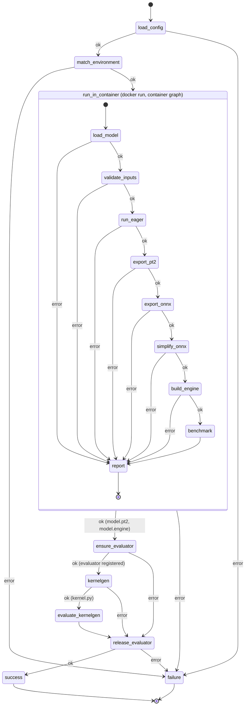

# Architecture

The check is two LangGraph state machines. The host graph validates the
user's config and environment, then starts the matched environment's Docker
container with the GPU attached and runs the container graph inside it. The
container graph writes `report.json` to a directory the host mounted; the host
merges it into its own state, so `failure` picks the customer message the
same way for both graphs. Once the container has succeeded, the host makes
sure an evaluator for the config's GPU and routing key is registered, starting
a Gaia worker container on this machine when none is, then runs the kernelgen
steps through the host's `yasp-toolkit` command. The user's Yasp API key stays
on the host; only a registration key scoped to registering enters the Gaia
worker, and the model-check container receives neither. A worker the host started is removed on
every path out of the kernelgen steps. The files the checks produce for the
user go to the artifact directory, which the host creates and mounts; the
container's `model.pt2` and `model.engine` in it are what the host's
`kernelgen` node depends on.

Every node either advances the state or records a failure stage in
`error` and `error_detail`; `route_on_error` sends any failure to `failure`,
except that from `ensure_evaluator` on it sends it through `release_evaluator`
first, which keeps the error it was given.

## Host graph

- `load_config` (`env_check.py`): reads and validates the user's `config.yaml`
  against the Pydantic schema in `config.py`: the five environment fields plus
  the `precision`, `metric`, `threshold`, and `eval_routing` settings, all
  required, and the optional `dependencies` list. Stages: `read_config`,
  `validate_config`.
- `match_environment` (`env_check.py`): loads `environments.yaml`, finds the
  entry equal to the config on the five environment fields, and checks the host GPU via
  `nvidia-smi` and the image via `docker image inspect`. Stages:
  `load_environments`, `match_environment`, `host_gpu`, `image_available`.
- `run_in_container` (`container.py`): creates the artifact directory,
  deletes the managed files listed in `artifacts.py` from a previous run, runs
  the container graph with `docker run --gpus all`, `model.py` and
  `input.npz` mounted read-only, the report and artifact directories mounted
  writable, and the precision and each of the config's `dependencies`
  (`--dependency`) passed on the command line, then validates `report.json` and requires the exit code
  to agree with it. Stage: `container_run`; a
  failure reported by the container is passed through under its own stage.
- `ensure_evaluator` (`evaluator_check.py`): runs `yasp-toolkit eval workers`
  filtered by the config's `eval_routing` and looks for a row whose GPU name
  and routing equal the config's `gpu` and `eval_routing` exactly. If there is
  none, mints scoped keys with `yasp-toolkit registry key` and `yasp-toolkit
  eval key` (their output is never logged), reads the worker image's tag
  list from `docker.yasp.ai` with the registry key and picks the newest
  release, logs in and pulls under a temporary Docker config, and runs
  `docker create` for a uniquely named `kronos-eval-*` container with the
  NVIDIA runtime, the Docker socket, the sibling-task settings of the Gaia
  Docker guide, and the registration key taken from the create client's
  environment. The container's command is `yasp-eval register --tag
  routing=<eval_routing>`, the image's own executable; the GPU name is not
  overridden. `docker start --attach` runs as a host subprocess whose output,
  the worker's, is captured to a temporary file. It records the container in
  `evaluator` and polls the listing until the row appears or a bounded time
  passes; an attached client that exits meanwhile fails with the output. A
  failure after `docker create` removes the container by name before the
  failure propagates. An evaluator that was already registered is not
  recorded. Stages: `evaluator_inventory`, `evaluator_command`, `evaluator_start`,
  `evaluator_ready` (plus the toolkit and credentials stages of kernelgen).
- `kernelgen` (`kernelgen_check.py`): requires `model.pt2` and `model.engine`
  in the artifact directory (the TensorRT output it waits for), then runs
  `yasp-toolkit kernelgen compile` as a subprocess with the reference, the
  user's `model.py` as source, the config's `gpu` as target, and the config's
  `eval_routing` for the in-compile evaluations; the command polls the job
  until it is terminal. Requires `kernel.py` to exist afterwards (the toolkit
  exits 0 after some early errors) and records its path in `kernel_path`.
  Stages: `kernelgen_reference`, `kernelgen_engine`, `kernelgen_toolkit`,
  `kernelgen_credentials`, `kernelgen_compile`.
- `evaluate_kernelgen` (`kernelgen_check.py`): runs `yasp-toolkit eval compare`
  on `kernel_path` against `model.pt2` for the config's `gpu`, routed to the
  evaluator registered from this machine by `eval_routing`; writes the
  evaluator's results as `kernelgen_eval.json`, requires its correctness
  checks to pass, and records the result and the speedup in
  `kernelgen_result` and `kernelgen_speedup`. Stages: `kernelgen_eval`,
  `kernelgen_eval_results`, `kernelgen_eval_incorrect` (plus the toolkit and
  credentials stages above).
- `release_evaluator` (`evaluator_check.py`): stops the container named in
  `evaluator`, if any, with `docker stop` bounded by a grace period, so the
  worker cancels its running task and tears down the sibling container the
  launcher runs it in (named `yasp-launcher-slot`, shared by every worker
  on the machine), then removes it with `docker rm --force` (one already
  gone counts as removed), reaps the attached client, killing it if it does
  not exit, and clears the key. With the worker gone it inspects the slot:
  the worker was created with `KRONOS_EVALUATOR=<container name>` in
  `YASP_LAUNCH_DOCKER_FORWARD_ENV`, so a slot whose environment carries that
  marker for this worker is its leftover and is removed; a slot without it
  is another worker's task and is left alone. Reached from every outcome of `ensure_evaluator`,
  `kernelgen`, and `evaluate_kernelgen`, so a worker the host started never
  outlives the check and one it did not start is never touched. A failure to remove is the
  stage `evaluator_release` only when no earlier failure is in state;
  otherwise it is logged and the earlier failure is kept.
- `success` / `failure` (`workflow.py`): set `outcome` and the
  `customer_message`: the benchmark numbers and the kernelgen speedup on
  success, or the message looked up by stage in `messages.py`.

## Container graph

Run by `python -m kronos_edge.eager_check` with `--device cuda` and the
`--precision`, `--threshold`, and `--dependency` values from the config.

- `load_model` (`eager_check.py`): selects the device, pip-installs the
  config's `dependencies` into the container's venv under a constraints file
  pinning every distribution already there (output captured, so
  stdout stays the user's), imports `model.py`, finds `Model` and
  `get_inputs()` or `get_fwd_args()`, and constructs the model. An import that
  raises `ModuleNotFoundError` is reported as `missing_dependency` with the
  module's name. Stages: `select_device`, `install_dependencies`,
  `import_module`, `missing_dependency`, `find_model_class`,
  `find_get_inputs`, `init_model`.
- `validate_inputs` (`eager_check.py`): calls `get_inputs()`, loads
  `input.npz`, and checks keys, shapes, and dtypes. Stages: `get_inputs`,
  `load_npz`, `validate_inputs`.
- `run_eager` (`eager_check.py`): one forward pass under `torch.no_grad()`
  on copies of the inputs. Stage: `forward`.
- `export_pt2` (`pt2_check.py`): `torch.export.export` on the model and
  inputs in state, under `torch.no_grad()`, decomposed to Core ATen (what
  `yasp-toolkit kernelgen export` produces); the model is not cast. Keeps the
  `ExportedProgram` in state and writes `model.pt2` with `torch.export.save`.
  Runs first after the eager pass so the host's kernelgen reference exists
  before the ONNX chain starts. Stages: `pt2_capture`, `pt2_save`.
- `export_onnx` (`onnx_check.py`): casts a copy of the model and its float
  inputs to the configured precision unless they already have it, leaving
  the eager model in state untouched; then
  `torch.onnx.export(..., dynamo=True)`; keeps the `ModelProto` in state and
  writes `model.onnx` with `ONNXProgram.save`, external data above 2 GB.
  Stages: `onnx_precision`, `onnx_exporter`, `onnx_capture`, `onnx_convert`,
  `onnx_save`.
- `simplify_onnx` (`onnxsim_check.py`): `onnxsim.simplify` on the model in
  state; keeps the result in state, writes `model_simplified.onnx` with
  external data above 2 GB, and checks the file with `onnx.checker`. Stages:
  `onnx_simplifier`, `onnx_simplify`, `onnx_simplified_invalid`,
  `onnx_simplified_save`.
- `build_engine` (`tensorrt_check.py`): parses `model_simplified.onnx` from
  the artifact directory into a strongly typed TensorRT network, so the
  engine's precision is the ONNX's, pins shape inputs and dynamic dimensions
  to the user's inputs with an optimization profile, builds a serialized
  engine, keeps the bytes in state, and writes `model.engine`. TensorRT's own log is forwarded to ours
  and its errors become the customer detail. Stages: `tensorrt_import`,
  `tensorrt_parse`, `tensorrt_build`, `engine_save`.
- `report` (`eager_check.main`): writes `error`, `error_detail`, and the
  `benchmark` to `report.json` and exits 1 on error, 0 otherwise.
