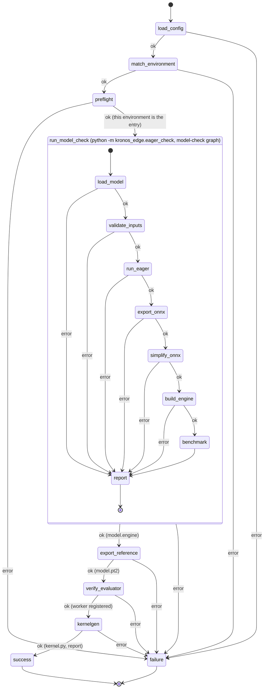

# Architecture

The check is two LangGraph state machines in one local workflow. The
workflow graph validates the user's config, matches it to a registry entry,
and verifies with a preflight that the Python environment it was started in,
native or a container built from the entry's Dockerfile, is that entry and has
`yasp-toolkit` on the path. It then runs the model-check graph as a
subprocess of the same interpreter; that graph writes `report.json` to a
temporary directory and the workflow merges it into its own state, so
`failure` picks the customer message the same way for both graphs. Once the
model check has succeeded, the workflow runs the documented `yasp-toolkit
kernelgen export` on the user's `model.py` to write the kernelgen reference,
confirms with `yasp-toolkit eval workers` that the user's persistent Gaia
worker for the config's GPU and routing key is registered, and runs
`yasp-toolkit kernelgen compile` and `yasp-toolkit eval inspect`. Every Yasp
interface used is a command documented at https://compile.yasp.ai/help/,
run as a subprocess with its output captured; the repository orchestrates
Gaia and implements none of it. The workflow process never imports the model
stack: torch, TensorRT, and the user's model live in the subprocesses. The
check never starts, stops, or removes a Gaia worker, never runs `docker`, and
mints no key. The files the checks produce for the user go to the artifact
directory; the export's `model.pt2` and the model check's `model.engine` in it
are what the `kernelgen` node depends on.

Every node either advances the state or records a failure stage in
`error` and `error_detail`; `route_on_error` sends any failure to `failure`.

## Workflow graph

- `load_config` (`env_check.py`): reads and validates the user's `config.yaml`
  against the Pydantic schema in `config.py`: the five environment fields plus
  the `precision`, `metric`, `threshold`, and `eval_routing` settings, all
  required, nothing else. Stages: `read_config`, `validate_config`.
- `match_environment` (`env_check.py`): loads `environments.yaml` and finds
  the entry equal to the config on the five environment fields. Stages:
  `load_environments`, `match_environment`.
- `preflight` (`preflight.py`): runs the probe `python -m
  kronos_edge.preflight` as a subprocess of this interpreter; it prints
  torch's version and CUDA build, TensorRT's version, and the GPU torch sees
  as JSON. The node compares them with the entry by version component
  (`11.4.0` accepts `11.4.0.106`, `2.14.1` accepts `2.14.1+cu130`; the GPU
  name must be equal; the driver is not checked), lists every difference at
  once with the entry's Dockerfile as the recipe, and requires `yasp-toolkit`
  on the path. Stages: `preflight_probe`, `environment_mismatch`,
  `kernelgen_toolkit`.
- `run_model_check` (`model_check.py`): creates the artifact directory,
  deletes the managed files listed in `artifacts.py` from a previous run, runs
  the model-check graph as `python -m kronos_edge.eager_check` with this
  interpreter, the package's source directory leading `PYTHONPATH`, stdout
  and stderr inherited, and the paths, precision, threshold, `--device cuda`,
  and log level on the command line, then validates `report.json` from a
  temporary directory and requires the exit code to agree with it. Stage:
  `model_check_run`; a failure reported by the subprocess is passed through
  under its own stage.
- `export_reference` (`kernelgen_check.py`): runs `yasp-toolkit kernelgen
  export --input model.py --output <artifacts>/model.pt2`
  (https://compile.yasp.ai/help/reference/kernelgen/#export) as a subprocess
  with its output captured, since the user's model prints on it. The exporter
  builds `Model(*get_init_inputs())`, calls `get_inputs()`, and saves the
  `torch.export` program with the toolkit's own torch, on whatever device that
  torch and the model choose; it never sees the benchmarked instance or
  `input.npz`. The node requires `model.pt2` afterwards. Stages:
  `export_reference` (plus `kernelgen_toolkit`).
- `verify_evaluator` (`evaluator_check.py`): runs `yasp-toolkit eval workers
  --tag routing=<eval_routing>`, bounded, and parses its table for a row whose
  GPU Name and Routing equal the config's `gpu` and `eval_routing` exactly.
  The worker is the user's persistent deployment from the Gaia Docker guide
  with a routing tag; without a match the check stops before any job is
  submitted. Nothing is started, stopped, or minted. Stages:
  `evaluator_inventory`, `evaluator_missing` (plus `kernelgen_toolkit`).
- `kernelgen` (`kernelgen_check.py`): requires `model.pt2` and `model.engine`
  in the artifact directory, then runs `yasp-toolkit kernelgen compile` with the
  reference alone (no `--source`), the config's `gpu` as target, and the
  config's `eval_routing` for the in-compile evaluations; the command polls the
  job until it is terminal. Requires `kernel.py` and `kernelgen_report.json`
  afterwards (the toolkit can exit 0 after an early error), then runs
  `yasp-toolkit eval inspect --file kernelgen_report.json` and keeps its
  rendering in `kernelgen_report` for the success message. No field of the
  report is read. Stages: `kernelgen_reference`, `kernelgen_engine`,
  `kernelgen_toolkit`, `kernelgen_compile`, `kernelgen_inspect`.
- `success` / `failure` (`workflow.py`): set `outcome` and the
  `customer_message`: the benchmark numbers and the inspected kernelgen report
  on success, or the message looked up by stage in `messages.py`.

## Model-check graph

Run by `python -m kronos_edge.eager_check` with `--device cuda` and the
`--precision` and `--threshold` values from the config.

- `load_model` (`eager_check.py`): selects the device, imports `model.py`,
  finds `Model` and `get_inputs()` or `get_fwd_args()`, and constructs the
  model. Nothing is installed: an import that raises `ModuleNotFoundError` is
  reported as `missing_dependency` with the module's name, for the user to
  install into this environment. Stages: `select_device`, `import_module`,
  `missing_dependency`, `find_model_class`, `find_get_inputs`, `init_model`.
- `validate_inputs` (`eager_check.py`): calls `get_inputs()`, loads
  `input.npz`, and checks keys, shapes, and dtypes. Stages: `get_inputs`,
  `load_npz`, `validate_inputs`.
- `run_eager` (`eager_check.py`): one forward pass under `torch.no_grad()`
  on copies of the inputs. Stage: `forward`.
- `export_onnx` (`onnx_check.py`): casts a copy of the model and its float
  inputs to the configured precision unless they already have it, leaving
  the eager model in state untouched; then
  `torch.onnx.export(..., dynamo=True)`; keeps the `ModelProto` in state and
  writes `model.onnx` with `ONNXProgram.save`, external data above 2 GB.
  Stages: `onnx_precision`, `onnx_exporter`, `onnx_capture`, `onnx_convert`,
  `onnx_save`.
- `simplify_onnx` (`onnxsim_check.py`): `onnxsim.simplify` on the model in
  state; keeps the result in state, writes `model_simplified.onnx` with
  external data above 2 GB, and checks the file with `onnx.checker`. Stages:
  `onnx_simplifier`, `onnx_simplify`, `onnx_simplified_invalid`,
  `onnx_simplified_save`.
- `build_engine` (`tensorrt_check.py`): parses `model_simplified.onnx` from
  the artifact directory into a strongly typed TensorRT network, so the
  engine's precision is the ONNX's, pins shape inputs and dynamic dimensions
  to the user's inputs with an optimization profile, builds a serialized
  engine, keeps the bytes in state, and writes `model.engine`. TensorRT's own log is forwarded to ours
  and its errors become the customer detail. Stages: `tensorrt_import`,
  `tensorrt_parse`, `tensorrt_build`, `engine_save`.
- `report` (`eager_check.main`): writes `error`, `error_detail`, and the
  `benchmark` to `report.json` and exits 1 on error, 0 otherwise.
