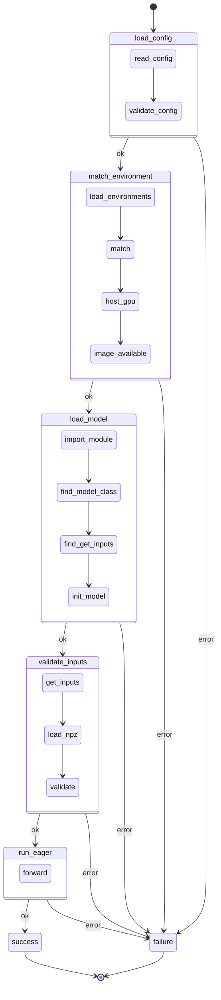

# Architecture

The check is a LangGraph state machine with five working nodes and two
terminal nodes. Every working node either advances the state or records a
failure stage; a shared routing function sends any failure straight to the
`failure` node.

## State flow

The inner boxes are the failure stages inside each node. A stage name is what
gets logged with the error and what the `failure` node uses to choose the
customer message.

## Components

| File | Role |
|---|---|
| `src/kronos_edge/log.py` | Thin wrapper over the standard `logging` module. Adds a `TRACE` level below `DEBUG`, a `configure()` that installs one stderr handler on the `kronos_edge` logger, and a `stage` field on every record. |
| `src/kronos_edge/state.py` | The shared `State` TypedDict, the `route_on_error` function used on every conditional edge, and `fail()`, which logs an error under its stage and returns the state update (`error`, `error_detail`) that routes to `failure`. Imports neither of the other two modules. |
| `src/kronos_edge/config.py` | Pydantic schema for the user's `config.yaml` (`EnvironmentConfig`: strict strings, pattern-checked versions, extra keys forbidden) and for the registry (`Environment`, `Registry`). `parse_config()` turns validation errors into one readable `InvalidConfig` message. |
| `src/kronos_edge/environments.yaml` | The registry of supported environments. One entry today: this machine. Each entry carries the five config fields plus `name`, `image`, and `dockerfile`. |
| `src/kronos_edge/env_check.py` | The environment check: `load_config` and `match_environment` nodes, their six stages, and the `image_exists()` and `host_gpu()` probes that shell out to `docker` and `nvidia-smi`. Tests replace the probes. |
| `docker/<name>/Dockerfile` | One Dockerfile per registry entry, pinning the same CUDA, TensorRT, and torch versions the entry declares. |
| `src/kronos_edge/eager_check.py` | The eager check itself: the `load_model`, `validate_inputs`, and `run_eager` nodes, the `InvalidUserInputs` exception, and the `CUSTOMER_MESSAGES` table mapping its eight stages to user-facing text. Owns the `model.py` and `input.npz` contracts. |
| `src/kronos_edge/workflow.py` | Composes the environment check and the eager check into the graph. Holds the `success` and `failure` terminal nodes, `build_graph()`, `run_check()`, and the command-line `main()`. The `failure` node reads the stage and detail from the run's own state, so concurrent runs never see each other's errors. |
| `tests/conftest.py` | Shared fixtures: a valid config and registry, a good model, and autouse patches so tests never call `docker` or `nvidia-smi`. |
| `tests/test_env_check.py` | Environment check tests: unreadable config, six schema violations, broken registry, a mismatch on each of the five fields, host GPU mismatch, missing image, and the CLI override. |
| `tests/test_eager_check.py` | End-to-end tests through `run_check()` and `main()`. Four success paths, thirteen failure stages, routing, exit codes, and a two-thread isolation test. Model and npz files are generated into a temporary directory. |

## Failure stages

| Node | Stage | Trigger |
|---|---|---|
| `load_config` | `read_config` | `config.yaml` missing or not valid YAML. |
| `load_config` | `validate_config` | A field missing, unknown, empty, unquoted, or not a dotted version. |
| `match_environment` | `load_environments` | The registry itself fails to load or validate. |
| `match_environment` | `match_environment` | No registry entry equals the config on all five fields. |
| `match_environment` | `host_gpu` | `nvidia-smi` reports a different GPU name or driver than the matched entry. |
| `match_environment` | `image_available` | `docker image inspect` does not find the entry's image. |
| `load_model` | `import_module` | `model.py` missing or fails to import. |
| `load_model` | `find_model_class` | No `Model`, or it is not a `torch.nn.Module` subclass. |
| `load_model` | `find_get_inputs` | Neither `get_inputs` nor `get_fwd_args` is defined. |
| `load_model` | `init_model` | `Model.__init__` has required parameters but `get_init_inputs()` is absent, or construction raises. |
| `validate_inputs` | `get_inputs` | `get_inputs()` raises. |
| `validate_inputs` | `load_npz` | `input.npz` missing or unreadable. |
| `validate_inputs` | `validate_inputs` | Wrong keys, count, shape, or dtype. |
| `run_eager` | `forward` | The forward pass raises. |

## Adding an environment

1. Add an entry to `src/kronos_edge/environments.yaml` with the five config
   fields, a `name`, an `image` tag, and the `dockerfile` path.
2. Add `docker/<name>/Dockerfile` pinning exactly those versions, and build it
   with the command in `README.md`.
3. Add the entry to the registry used in `tests/conftest.py` if a test should
   match it.

## Adding a check

1. Put its nodes and its own `CUSTOMER_MESSAGES` table in a new module next
   to `eager_check.py`. Each node wraps its body in one `try/except` and
   returns `fail(logger, stage, exc)` on error.
2. Register the nodes and edges in `workflow.build_graph()`, reusing
   `route_on_error`, and merge the message table into
   `workflow.CUSTOMER_MESSAGES`.
3. Add its scenarios to the parametrized tables in `tests/test_eager_check.py`
   before writing the nodes.
