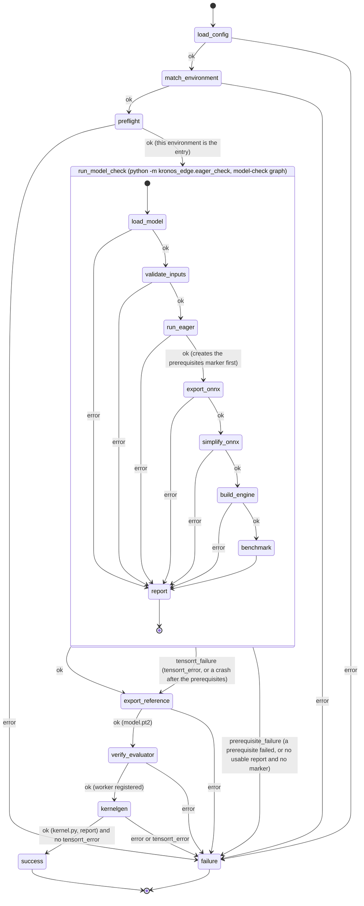

# Architecture

The check is two LangGraph state machines in one local workflow. The
workflow graph validates the user's config, matches it to a registry entry,
and verifies with a preflight that the Python environment it was started in,
native or a container built from the entry's Dockerfile, is that entry and has
`yasp-toolkit` on the path. It then runs the model-check graph as a
subprocess of the same interpreter; that graph writes `report.json` to a
temporary directory and the workflow merges it into its own state, so
`failure` picks the customer message the same way for both graphs. The model
check's prerequisites (loading the model, validating `input.npz`, the eager
forward) gate everything after them. Past them, the check has two independent
branches, run in this order: the ONNX/TensorRT branch inside the model check,
then the kernelgen branch. A failure in the first is kept in `tensorrt_error`
and `tensorrt_error_detail` and the kernelgen branch still runs; a kernelgen
failure, in `error` and `error_detail`, keeps the first branch's files and
benchmark. Either failure fails the run, and the message reports both
branches. The kernelgen branch runs the documented `yasp-toolkit
kernelgen export` on the user's `model.py` to write the kernelgen reference,
confirms with `yasp-toolkit eval workers` that the user's persistent Gaia
worker for the config's GPU and routing key is registered, and runs
`yasp-toolkit kernelgen compile` and `yasp-toolkit eval inspect`. Every Yasp
interface used is a command documented at https://compile.yasp.ai/help/,
run as a subprocess with its output captured; the repository orchestrates
Gaia and implements none of it. The workflow process never imports the model
stack: torch, TensorRT, and the user's model live in the subprocesses. The
check never starts, stops, or removes a Gaia worker, never runs `docker`, and
mints no key. The files the checks produce for the user go to a new run
directory under the artifact root, named for the run's UTC start time
(`.artifact/20261017T143005Z/` by default); its path travels in state as
`run_path`, and the export's `model.pt2` in it is what the `kernelgen` node
depends on; it does not wait for `model.engine`. Earlier run directories are
never touched.

Every node either advances the state or records a failure stage in
`error` and `error_detail`; `route_on_error` sends any failure to `failure`.
The one exception is a failure of the ONNX/TensorRT branch, which
`run_model_check` records in `tensorrt_error` and `tensorrt_error_detail`;
`route_after_model_check` sends it to the kernelgen branch as
`tensorrt_failure`, and only a `prerequisite_failure` to `failure`. After
`kernelgen`, either kind of failure routes to `failure`.

## Process boundaries

- The workflow process imports neither torch nor numpy and never runs user
  code. Only the model-check graph's modules (`eager_check`, `onnx_check`,
  `onnxsim_check`, `tensorrt_check`, `benchmark_check`) import the model
  stack, and the preflight's probe does so only in its subprocess
  (`test_host_imports_without_torch_or_numpy`). Inside those modules, `onnx`,
  `onnxsim`, and the exporter's lazy imports happen inside the node that needs
  them, so a missing package becomes a reported stage rather than a crash
  before `report.json` is written.
- The model-check subprocess talks to the workflow only through `report.json`
  and the prerequisites marker in a temporary directory, never through stdout,
  which belongs to the user's model. Its logs go to stderr, which the workflow
  inherits.
- The processes that run the user's model, the model-check subprocess and
  `kernelgen export`, start without `YASP_*` and `REGISTRY_KEY` and with
  Python's keyring set to its null backend; the export needs no key. The
  service commands (`eval workers`, `kernelgen compile`, `eval inspect`) keep
  the full environment they authenticate with. This withholds the
  credentials; it is not a sandbox, since the model still runs as the user.
- Every Yasp interaction is a documented `yasp-toolkit` command run as a
  subprocess with its output captured; the toolkit alone reads the Yasp API
  key. The toolkit can exit 0 after an early error, so each node requires the
  files it asked for instead of trusting the exit code. No `yasp-compile-*`
  package is a dependency or an import
  (`test_no_yasp_package_is_a_dependency_of_the_project`), and no field of a
  Yasp report is parsed.
- The same workflow serves a native install and a container built from an
  entry's Dockerfile: it verifies whichever Python environment it was started
  in and does not ask which kind it is. Dockerfiles under `docker/` are
  recipes for the registry's environments and validation fixtures, not
  run-time requirements: `test_each_registry_entry_has_a_dockerfile_stating_the_same_versions`
  compares each entry with its Dockerfile's labels, and
  `test_the_check_runs_no_docker_command` keeps `docker` out of `src/`.

## Run directory

The workflow creates the run directory exclusively before the model check, so
every run starts empty and no stale file sits next to a fresh one; it deletes
nothing, so earlier runs and anything else under the artifact root are never
touched. Every file a node writes there is listed in `artifacts.py`
(`test_managed_names_agree_with_the_nodes_that_write_them`). Each node writes
its file as soon as it has it, so a later failure keeps the earlier files,
and intermediate models also stay in state, in memory, for the next node.
Models above the 2 GB protobuf limit are saved with external data and checked
by path; the onnxsim step is unverified above that size.

## Workflow graph

- `load_config` (`env_check.py`): reads and validates the user's `config.yaml`
  against the Pydantic schema in `config.py`: the five environment fields plus
  the `precision`, `metric`, `threshold`, and `eval_routing` settings, all
  required, nothing else. `config.Config` is the environment schema plus the
  settings. Settings never take part in matching, so changing one re-runs the
  checks in the same environment into a new run directory. A metric is
  accepted only once it is implemented, and the threshold is always the
  user's. Stages: `read_config`, `validate_config`.
- `match_environment` (`env_check.py`): loads `environments.yaml` and finds
  the entry equal to the config on the five environment fields. Stages:
  `load_environments`, `match_environment`.
- `preflight` (`preflight.py`): runs the probe `python -m
  kronos_edge.preflight` as a subprocess of this interpreter; it prints
  torch's version and CUDA build, TensorRT's version, and the GPU torch sees
  as JSON. The node compares them with the entry by version component
  (`11.4.0` accepts `11.4.0.106`, `2.14.1` accepts `2.14.1+cu130`; the GPU
  name must be equal; the driver is not checked), lists every difference at
  once with the entry's Dockerfile as the recipe, and requires `yasp-toolkit`
  on the path. The config's `driver` field only identifies the registry
  entry: it documents the environment the entry was validated with, and there
  is no driver-version gate. Stages: `preflight_probe`, `environment_mismatch`,
  `kernelgen_toolkit`.
- `run_model_check` (`model_check.py`): creates the artifact root if missing
  and, exclusively, this run's directory in it, named for the UTC start time
  (`20261017T143005Z`, or the next free `-2`, `-3`, ... suffix if the name is
  taken), and records it as `run_path`; deletes nothing. Runs
  the model-check graph as `python -m kronos_edge.eager_check` with this
  interpreter, the package's source directory leading `PYTHONPATH`, the Yasp
  credentials (`YASP_*`, `REGISTRY_KEY`) removed from its environment and
  Python's keyring disabled, stdout and stderr inherited, and the paths, precision, threshold, `--device cuda`,
  and log level on the command line, then validates `report.json` from a
  temporary directory and requires the exit code to agree with it; a success
  report without a benchmark, or one carrying a non-finite metric value, is
  not usable. Stage:
  `model_check_run`; a failure reported by the subprocess is passed through
  under its own stage: in `error` for a prerequisite stage (loading the model,
  validating the inputs, the eager forward), which stops the run, and in
  `tensorrt_error` for a stage of the ONNX/TensorRT branch (ONNX export,
  onnxsim, engine build, benchmark), after which the kernelgen branch still
  runs. Before the ONNX/TensorRT branch starts, the subprocess creates the
  prerequisites marker (`--prerequisites`, next to `report.json`). If it then
  leaves no usable report (it crashed, was killed, or its exit code disagrees
  with the report), the marker shows the prerequisites passed, so the failure
  is `model_check_crash` in `tensorrt_error`, with the exit code, and the
  kernelgen branch still runs. Without the marker it is `model_check_run`: the
  prerequisites are not known to have passed, so it stops the run.
- `export_reference` (`kernelgen_check.py`): runs `yasp-toolkit kernelgen
  export --input model.py --output <run_path>/model.pt2`
  (https://compile.yasp.ai/help/reference/kernelgen/#export) as a subprocess
  with its output captured, since the user's model prints on it, and without
  the Yasp credentials or the keyring, since it runs the user's model; the
  other toolkit commands keep them. The exporter
  builds `Model(*get_init_inputs())`, calls `get_inputs()`, and saves the
  `torch.export` program with the toolkit's own torch, on whatever device that
  torch and the model choose; it never sees the benchmarked instance or
  `input.npz`, since no documented command takes weights or input arrays.
  The check forces neither the CPU nor the GPU; a GPU-traced reference once
  failed on the kernelgen service with `Torch not compiled with CUDA enabled`
  while CPU references were accepted, a known risk of the user's setup that
  the check does not enforce. The node requires `model.pt2` afterwards. Stages:
  `export_reference` (plus `kernelgen_toolkit`).
- `verify_evaluator` (`evaluator_check.py`): runs `yasp-toolkit eval workers
  --tag routing=<eval_routing>`, bounded, and parses its table for a row whose
  GPU Name and Routing equal the config's `gpu` and `eval_routing` exactly.
  The toolkit has no machine-readable output, so the table is parsed. The
  worker is the user's persistent deployment from the Gaia Docker guide
  with a routing tag; a job routed to a pool with no worker waits forever, so
  without a match the check stops before any job is submitted. Nothing is
  started, stopped, or minted. Stages:
  `evaluator_inventory`, `evaluator_missing` (plus `kernelgen_toolkit`).
- `kernelgen` (`kernelgen_check.py`): requires `model.pt2` in the run
  directory, then runs `yasp-toolkit kernelgen compile` with the
  reference alone (no `--source`), the config's `gpu` as target, and the
  config's `eval_routing` for the in-compile evaluations; the command polls the
  job until it is terminal. Requires `kernel.py` and `kernelgen_report.json`
  afterwards (the toolkit can exit 0 after an early error), then runs
  `yasp-toolkit eval inspect --file kernelgen_report.json` and keeps its
  rendering in `kernelgen_report` for the success message. No field of the
  report is read: Gaia returns only a kernel that passed its worker's checks,
  and the check judges nothing itself, nor derives any expectation from
  TensorRT versus the eager run. `eval_routing` is required because a worker
  with no routing tag joins the shared pool, where any job could take it.
  Stages: `kernelgen_reference`, `kernelgen_toolkit`, `kernelgen_compile`,
  `kernelgen_inspect`.
- `success` / `failure` (`workflow.py`): set `outcome` and the
  `customer_message`: the benchmark numbers and the inspected kernelgen report
  on success. On failure, each branch's result in order: the benchmark or the
  ONNX/TensorRT failure, the kernelgen kernel if one was produced, then the
  failure in `error`, each failure as the message looked up by stage in
  `messages.py` with its detail. `messages.py` holds all customer-facing
  text, one table per check keyed by stage; `messages.merge()` joins them into
  one flat namespace and rejects duplicate stage names.

## Model-check graph

Run by `python -m kronos_edge.eager_check` with `--device cuda` and the
`--precision` and `--threshold` values from the config.

- `load_model` (`eager_check.py`): selects the device, imports `model.py`,
  finds `Model` and `get_inputs()` or `get_fwd_args()`, and constructs the
  model. Nothing is installed: an import that raises `ModuleNotFoundError` is
  reported as `missing_dependency` with the module's name, for the user to
  install into this environment. Stages: `select_device`, `import_module`,
  `missing_dependency`, `find_model_class`, `find_get_inputs`, `init_model`.
- `validate_inputs` (`eager_check.py`): calls `get_inputs()`, loads
  `input.npz`, and checks keys, shapes, and dtypes. Stages: `get_inputs`,
  `load_npz`, `validate_inputs`.
- `run_eager` (`eager_check.py`): one forward pass under `torch.no_grad()`
  on copies of the inputs. Stage: `forward`.
- `export_onnx` (`onnx_check.py`): casts a copy of the model and its float
  inputs to the configured precision unless they already have it, for both
  `fp32` and `fp16`, leaving the eager model in state untouched; this is the
  only place precision is applied. Then
  `torch.onnx.export(..., dynamo=True)`; keeps the `ModelProto` in state and
  writes `model.onnx` with `ONNXProgram.save`, external data above 2 GB.
  Stages: `onnx_precision`, `onnx_exporter`, `onnx_capture`, `onnx_convert`,
  `onnx_save`.
- `simplify_onnx` (`onnxsim_check.py`): `onnxsim.simplify` on the model in
  state; keeps the result in state, writes `model_simplified.onnx` with
  external data above 2 GB, and checks the file with `onnx.checker`. Stages:
  `onnx_simplifier`, `onnx_simplify`, `onnx_simplified_invalid`,
  `onnx_simplified_save`.
- `build_engine` (`tensorrt_check.py`): parses `model_simplified.onnx` from
  the run directory into a strongly typed TensorRT network, so the
  engine's precision is the ONNX's, pins shape inputs and dynamic dimensions
  to the user's inputs with an optimization profile, builds a serialized
  engine, keeps the bytes in state, and writes `model.engine`. TensorRT 11
  has no precision builder flags, which is why the network is strongly typed.
  Nothing is generalized beyond the inputs the user supplied. TensorRT's own
  log is forwarded to ours and its errors become the customer detail. The
  real build is the module-level `tensorrt_check.build`, which the tests stub.
  Stages: `tensorrt_import`, `tensorrt_parse`, `tensorrt_build`,
  `engine_save`.
- `benchmark` (`benchmark_check.py`): times eager as the user wrote the model
  and the engine at the configured precision, each with 20 warm-up runs then
  200 timed runs, and reports mean, median, and p95 in ms for both, with the
  speedup as the ratio of medians. The reference outputs, the timing loop,
  and the engine each run on their own copies of the inputs, since a model may
  update its inputs in place. Outputs are flattened with pytree, as the
  exporter does, so tuples, lists, and dicts (insertion order) pair with the
  engine's outputs by position; every pair must reach the threshold, and a
  non-finite metric value fails. Writes `benchmark.json`. The engine runner
  (`benchmark_check.load_engine`, stubbed in the tests) keeps the TensorRT
  `Runtime` alive as long as the engine and reads shape-tensor inputs from
  host memory, both segfaults otherwise, and gives an output whose shape is
  unknown after shape inference (data-dependent, such as `nonzero`) a TensorRT
  output allocator instead of a preallocated buffer. Stages:
  `benchmark_eager`, `benchmark_engine`, `benchmark_runtime`,
  `compare_outputs`, `accuracy`.
- `report` (`eager_check.main`): writes `error`, `error_detail`, and the
  `benchmark` to `report.json` and exits 1 on error, 0 otherwise.
